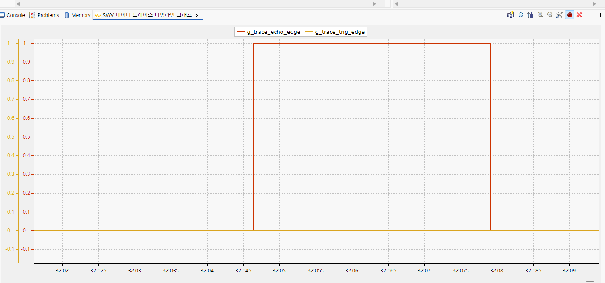
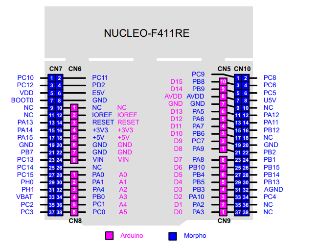
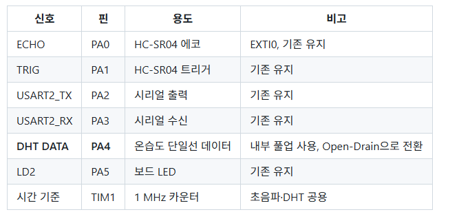
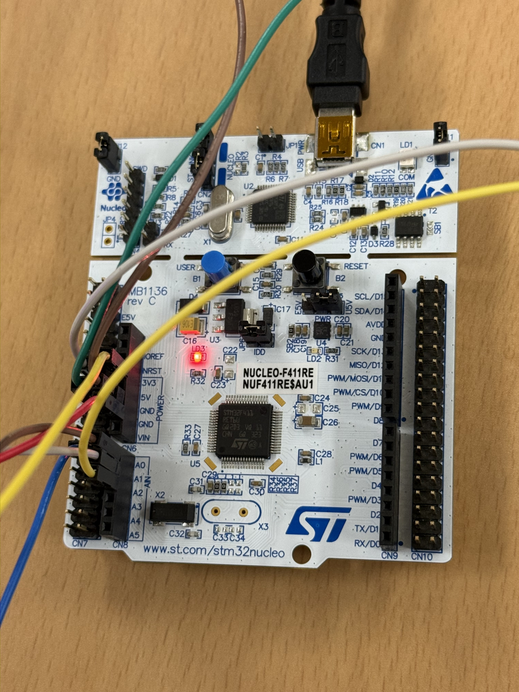
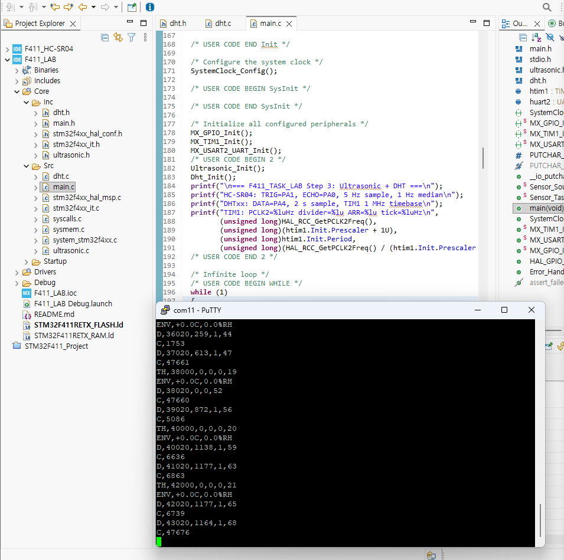
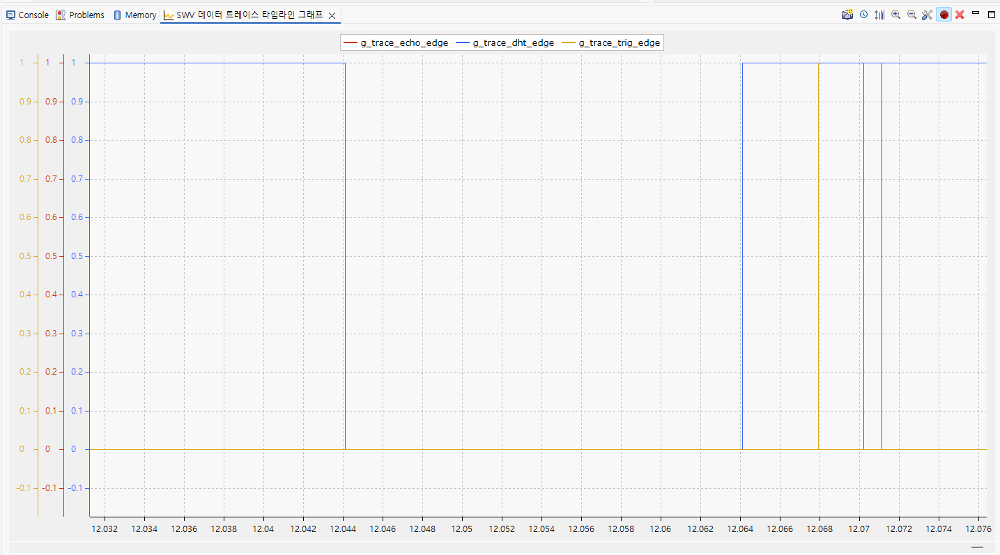

# F411_LAB
F411_LAB

<b>초음파 거리 측정</b>

HC-SR04로 거리를 측정한다.

### 하드웨어

| 항목 | 내용 |
|------|------|
| 보드 | NUCLEO-F411RE (STM32F411RE) |
| 센서 | HC-SR04 |
| TRIG | PA1 (출력) |
| ECHO | PA0 (EXTI 입력) |
| 타이머 | TIM1, 1 MHz (1 tick = 1 µs) |
| 시리얼 | USART2, 115200 8N1 (PuTTY로 확인) |

### SWV

<b>초음파+온습도</b>

