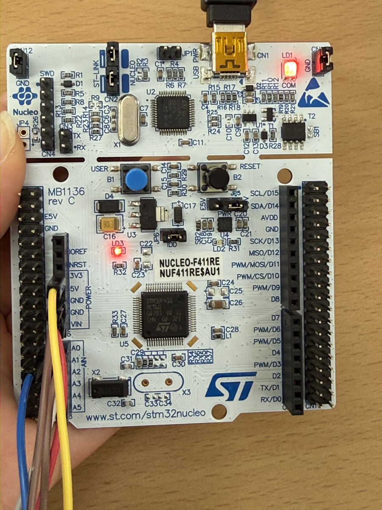
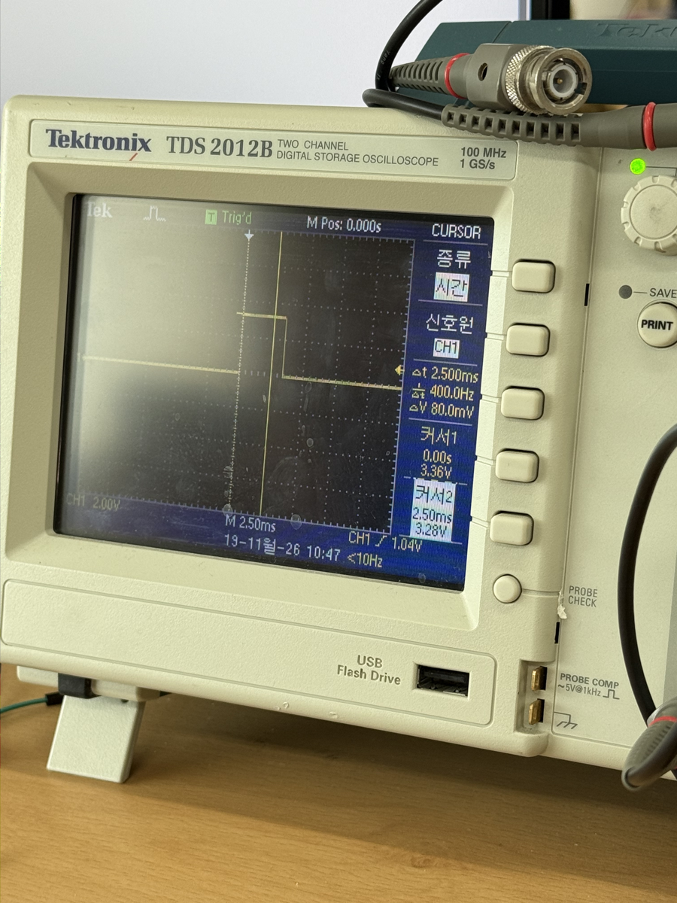

# F411_LAB
F411_LAB

## 초음파 거리 측정

HC-SR04로 거리를 측정한다.



### 하드웨어

| 항목 | 내용 |
|------|------|
| 보드 | NUCLEO-F411RE (STM32F411RE) |
| 센서 | HC-SR04 |
| TRIG | PA1 (출력) |
| ECHO | PA0 (EXTI 입력) |
| 타이머 | TIM1, 1 MHz (1 tick = 1 µs) |
| 시리얼 | USART2, 115200 8N1 (PuTTY로 확인) |

### 측정 흐름

1. 200 ms마다 TRIG(PA1)를 10 µs 동안 High로 출력한다.
2. ECHO(PA0) Rising 인터럽트에서 TIM1 카운터 값을 저장한다.
3. ECHO Falling 인터럽트에서 카운터 값을 읽고, `(uint16_t)(fall - rise)`로 Echo 폭(µs)을 계산한다.
4. Echo 폭이 유효 범위(100 ~ 30000 µs)이면 거리로 변환하고, 범위를 벗어나면 에러로 카운트한다.
5. 거리(mm) = Echo 폭(µs) × 음속(343 m/s) ÷ 2 로 계산한다. 유효 거리는 20 ~ 4000 mm이다.
6. 5개 샘플의 중앙값(median)을 1초마다 출력한다.
7. Echo가 35 ms 안에 들어오지 않으면 타임아웃으로 처리한다.

### 시리얼 출력 형식

```
D,<timestamp_ms>,<distance_mm>,<valid>,<errors>
C,<echo_width_us>
```

| 줄 | 의미 |
|----|------|
| `D` | 1초마다 출력되는 중앙값 결과. 시각(ms), 거리(mm), 유효 여부(1=유효), 누적 에러 수 |
| `C` | 마지막으로 측정한 Echo 폭(µs) |

예: `D,7000,295,1,0` → 7000 ms 시점에 295 mm, 유효, 에러 0회


### 오실로스코프 측정


